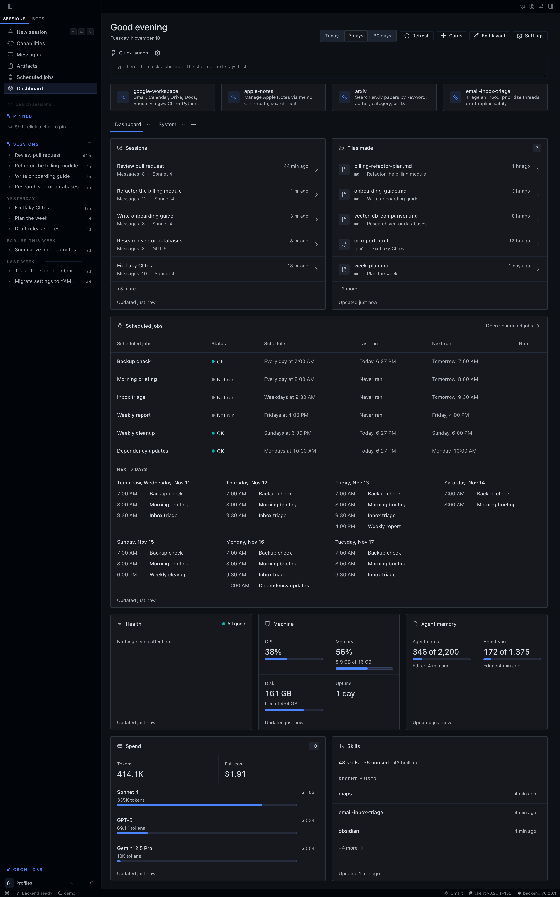
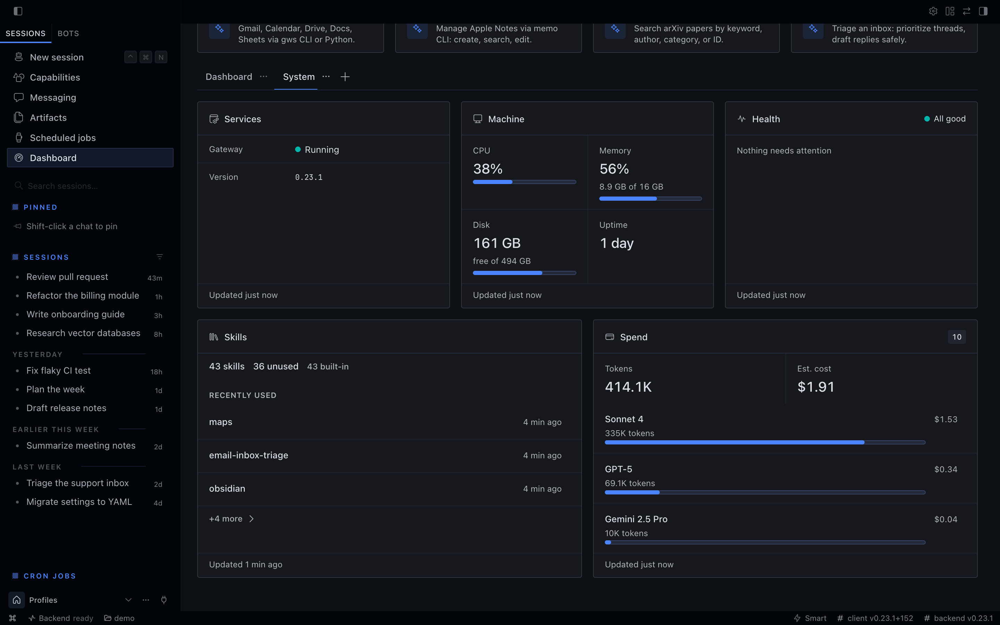
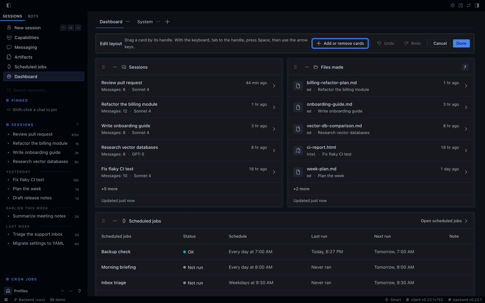
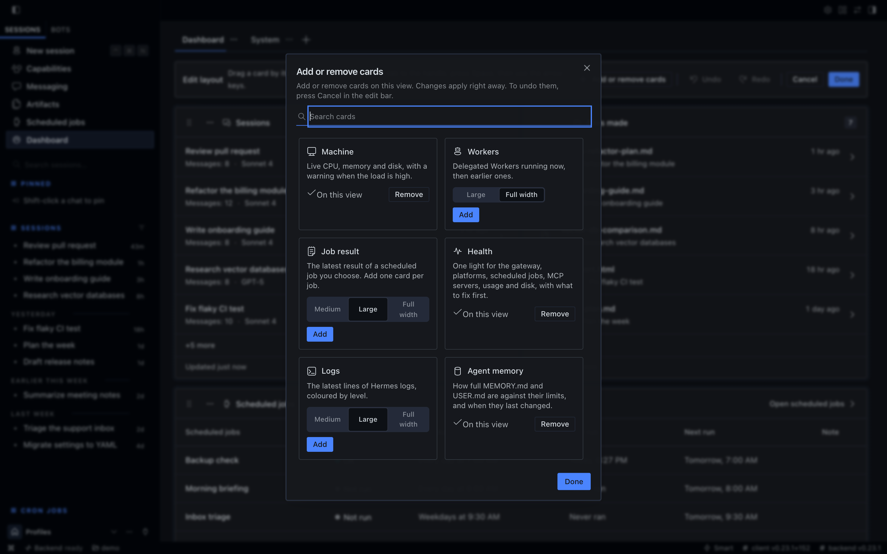
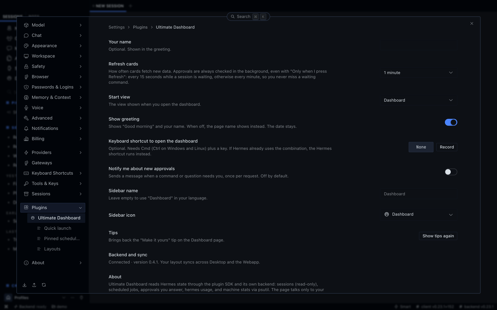

# Ultimate Dashboard


A dashboard page for Hermes Desktop and the Webapp. It puts what your agent is doing on one screen: commands waiting for your approval, running sessions, scheduled jobs, usage and spend, and the health of the gateway and the machine it runs on. You choose the cards and arrange them, and the layout is shared between Desktop and the Webapp.

Requires Hermes 0.23.0 or later. The page follows the Hermes theme and language (English and Arabic, with right-to-left layout).

## Install

```
hermes plugins install Yazeed-A-H/Ultimate-Dashboard/plugin
hermes plugins enable ultimate-dashboard
hermes gateway restart
```

Run the commands in a terminal, or ask your Hermes agent to run the first two. The gateway restart has to come from a terminal, because Hermes does not restart its own gateway from inside a chat.

Then open **Capabilities → Plugins → Ultimate Dashboard** in Hermes Desktop and turn on **Desktop**. The page appears in the sidebar as **Dashboard**.

Enable the plugin in every Hermes profile that should show data. Other install methods (clone and link, Windows, remote gateway), updating and uninstalling are covered in [plugin/README.md](plugin/README.md).

## Cards

| Card | What it shows |
| --- | --- |
| Needs my approval | Commands waiting in running sessions, shown in full, and questions a session asked you. A command is answered only when you click, with Approve once or Reject, never "always". |
| Sessions | Sessions working now, then your latest ones. |
| Scheduled jobs | Every scheduled job with its last and next run, pinned jobs first, and a timeline of the next 7 days. |
| Job result | The latest output of a scheduled job you pick. Add one card per job. |
| Usage | Plan usage per provider (from `hermes usage`), with the one nearest its limit first. |
| Spend | Tokens and estimated cost by model, and the biggest sessions. |
| Activity | Recent tool calls, and which tools fail most. |
| Live tasks | What the main agent and each Worker are doing right now, with a progress bar per Worker. |
| Health | One light for the gateway, platforms, scheduled jobs, MCP servers, usage and disk, with what to fix first. |
| Services | Gateway, platforms and version. |
| Machine | CPU, memory, disk and uptime, with a warning when the load is high. |
| Logs | The latest lines of the Hermes logs, coloured by level. |
| Agent memory | How full `MEMORY.md` and `USER.md` are against their limits, and when they last changed. Never their text. |
| Skills | Skills by origin, the ones you never use, and what you used or added lately. |
| Files made | Files the agent made in sessions, with a count. |
| Workers | Delegated Workers running now, then earlier ones. |

Quick launch sits above the cards: shortcuts that type a skill or a prompt into a new chat. Nothing is sent until you press Send.

## Layout

- Views are tabs on the page, each with its own cards. You start with Dashboard and System and can add your own.
- Edit layout lets you drag cards by their handle or move them with the keyboard, change their size, and add or remove cards from a gallery, with undo and redo.
- Templates: Overview, System and Minimal are built in, and any view can be saved as a template of your own.
- Each card has its own settings, and the page has a time range (Today, 7 days, 30 days) and a refresh interval.
- The layout is stored on the gateway, so Desktop and the Webapp show the same one. You can export it and import it in Settings.

## Screenshots



| System | Edit layout |
| --- | --- |
|  |  |

| Add or remove cards | Settings |
| --- | --- |
|  |  |

## Privacy and disclosures

No telemetry, no third-party servers. The page talks only to your Hermes gateway. The one outside contact is indirect: the Usage card runs `hermes usage` on the gateway, which asks each signed-in provider for your plan usage.

The backend reads `state.db` read-only, scheduled job output files in `cron/output` (read only), the size, modified time and character count of `memories/MEMORY.md` and `memories/USER.md` (never their text) with your memory settings, the dates in `skills/.usage.json`, Hermes' Worker transcripts in `cache/delegation/live` (read only: goals, tool names and one-line command previews, never result text), and machine stats with `psutil`, and keeps the layout in `plugin-data/ultimate-dashboard/state.json`. Anyone signed in to your dashboard can see the session titles, file paths, Worker goals and command previews the cards show. A layout export includes your shortcut prompt text.

The full list (RPC methods, shell command, reads, storage, background timers) is in [plugin/README.md](plugin/README.md#disclosure-what-the-plugin-reads-runs-stores-and-sends).

## Compatibility

Hermes 0.23.0 or later. The Desktop app and the Webapp were exercised on macOS. On Ubuntu and Windows, CI installs the plugin into a running Hermes and checks its backend routes, and runs the unit tests; the page itself was not exercised there. Details: [plugin/README.md](plugin/README.md#platforms).

## Development

```
npm ci
npm run build    # src/ -> plugin/desktop/plugin.js
npm test         # Node and Python tests
```

Needs Node 26 and Python 3.9 or later. The built bundle is committed, and a test fails when it no longer matches `src/`, so rebuild before you commit.

| Path | Contents |
| --- | --- |
| `src/state/` | Layout logic, no UI |
| `src/ui/` | The React page, built on `@hermes/plugin-sdk` |
| `plugin/` | The installable plugin: manifest, built bundle and backend |
| `tests/` | Node and Python tests |
| `tools/` | Build script, CI driver and screenshot generator |

CI runs the tests on Ubuntu for every pull request that changes code. A release also runs them on Windows and installs the plugin into a real Hermes on Ubuntu and Windows.

To add a card, follow [docs/ADD-A-CARD.md](docs/ADD-A-CARD.md).

## Licence

MIT, see [LICENSE](LICENSE).
